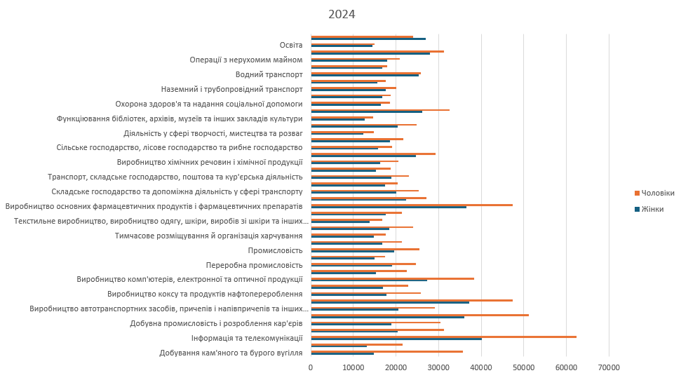
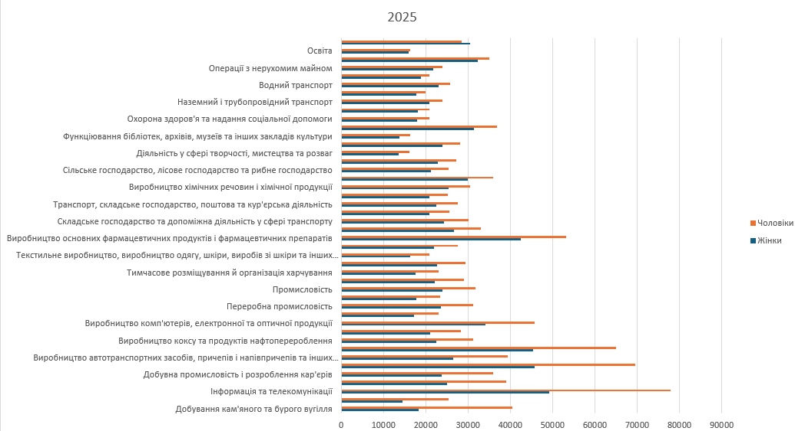

# gender-pay-gap-ukraine-excel
Excel-аналіз гендерного розриву в оплаті праці в Україні за видами економічної діяльності, 2024–2025 (формули, діаграми, парний t-тест)
Це аналітичний проєкт в Excel, у якому проведено дослідження різницю в середньомісячній заробітній платі чоловіків і жінок за 44 видами економічної діяльності в Україні за 2024 та 2025 роки. Мета проєкту - показати, в яких галузях розрив в оплаті найбільший і найменший, та перевірити статистично, чи є різниця між середньою зарплатою чоловіків і жінок значущою. Дані взято з офіційної статистики щодо середньої номінальної заробітної плати штатних працівників у розрізі статі та виду економічної діяльності (Державна служба статистики України, https://stat.gov.ua/uk/topics/rynok-pratsi). У файлі три аркуші: «Raw data» з вихідною вибіркою, «Аналіз» з підготовленою таблицею, формулами та діаграмами і «t-test» з результатами статистичного тесту. У ході роботи було очищено та переструктурувано вихідні дані, зіставлено зарплати жінок і чоловіків за кожною галуззю, розрахувано формулами співвідношення зарплат чоловіків до зарплат жінок за обидва роки, побудувано діаграми для наочного порівняння та проведено парний двовибірковий t-тест для середніх у надбудові «Аналіз даних». З основних результатів видно, що найбільший розрив спостерігається у видобуванні кам'яного та бурого вугілля, де чоловіки заробляють у 2,4 раза більше у 2024 році й у 2,2 раза більше у 2025 році, також високий розрив зафіксовано у сфері мистецтва, спорту та розваг, в інформації та телекомунікаціях, у торгівлі та у фінансовій діяльності, а найменший розрив, а подекуди й невелика перевага жінок, виявлено у сфері надання інших видів послуг, в освіті та державному управлінні. Середня зарплата чоловіків за вибіркою становила близько 25 860 грн, жінок — близько 20 173 грн, а парний t-тест показав статистично значущу різницю (t = −7,62, p < 0,001, df = 43), яка означає, що в середньому по галузях чоловіки отримують більше. Проте важливо враховувати обмеження - дані агреговані за галузями та не враховують посаду, стаж, рівень освіти й кількість відпрацьованих годин, тому результати показують розрив у середній оплаті, але не дозволяють робити висновки про причини чи про дискримінацію. У проєкті використано формули Excel, порівняння показників, діаграми та базову статистику (парний t-тест).

## Діаграми

